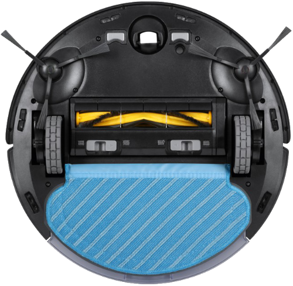

.. index:: Plugins; deebot
.. index:: deebot

======
deebot
======

.. important::

   Das Plugin benötigt **Python 3.14 oder neuer**, auch wenn SmartHomeNG selbst ältere Python-Versionen
   unterstützt. Unter einer älteren Version lädt SmartHomeNG das Plugin nicht und meldet das im Log.

Das Plugin liest den Zustand eines Ecovacs Deebot Saugroboters und steuert ihn: Start, Pause, Stopp,
Rückkehr zur Ladestation, Orten, Saugstufe, Wassermenge und die Reinigung einzelner Räume. Liefert das Gerät
eine Karte, gibt das Plugin sie samt Position des Roboters als SVG aus.

Es nutzt die Bibliothek `deebot-client <https://pypi.org/project/deebot-client/>`_, die auch die
Home Assistant Integration für Ecovacs verwendet. Unterstützt werden die Geräteklassen, für die diese
Bibliothek eine Definition enthält, darunter der Deebot N20 Pro Plus (Klassen ``qhe2o2``, ``gwtll7``,
``p0l0af``) und die Deebot Ozmo 920/950 (Klassen ``yna5xi``, ``vi829v``, ``9rft3c``, ``eazo2f``). Für die
Ozmo 960 enthält die Bibliothek keine eigene Definition. Ältere Geräte haben teils weniger Funktionen
(z.B. keine Station); die zugehörigen Items bleiben dann unverändert.

Das Plugin ersetzt das veraltete Plugin ``deebot_ozmo``. Dessen Konfiguration lässt sich nicht
übernehmen: ``deebot_ozmo`` bindet Items über Structs ein, dieses Plugin über das Attribut ``deebot``.

.. important::

   Die Verbindung läuft ausschließlich über die Ecovacs Cloud. Das Plugin braucht dafür die Zugangsdaten
   des Ecovacs Kontos; im lokalen Netz kann es den Roboter nicht direkt ansprechen.

Voraussetzungen
===============

- Python 3.14 oder neuer (Voraussetzung von ``deebot-client`` ab Version 18.7.0).
- Ein Ecovacs Konto, in dem der Roboter eingerichtet ist.

Konfiguration
=============

Die Informationen zur Konfiguration des Plugins sind unter :doc:`/plugins_doc/config/deebot`
beschrieben.

.. code-block:: yaml

    deebot:
        plugin_name: deebot
        account: 'me@example.org'
        password: 'secret'
        country: DE

Eigene Raumnamen und mehrere Karten
-----------------------------------

Die Räume tragen die Namen aus der Ecovacs App, unbenannte Räume heißen ``Default``. Über den Parameter
``room_names`` lassen sich eigene Namen vergeben, ohne sie in der App pflegen zu müssen. Sie haben Vorrang vor
den Namen aus der App und erscheinen im Item ``rooms``, im Web Interface und im Widget.

Ein Roboter kann mehrere Karten speichern, etwa eine je Stockwerk. Das Plugin zeigt immer die Karte, die der
Roboter gerade verwendet, und deren Räume. Da Raum-IDs nur innerhalb einer Karte sicher eindeutig sind, lassen
sich die Einstellungen je Karte angeben. Welche Karten gespeichert sind, zeigt das Item ``maps``
(``[{'id': '10', 'name': 'EG', 'active': True, 'built': True}, ...]``); jeder Eintrag in ``rooms`` nennt im
Feld ``map`` die Karte, zu der der Raum gehört.

Beide Parameter sind Listen von Einträgen. Raum-IDs und Karten stehen dabei als Werte, nicht als Schlüssel,
weil SmartHomeNG beim Einlesen der Konfiguration Schlüssel verwirft, die mit einer Ziffer beginnen.

Die Karte gibt man mit ``map`` über ihren Namen aus der Ecovacs App (z.B. ``EG``) oder über ihre ID an. Passt
ein Wert sowohl auf die ID einer Karte als auch auf den Namen einer anderen, gilt die ID. Namen greifen erst,
sobald der Roboter die Kartenliste gemeldet hat (Item ``maps``); bis dahin und für Karten ohne Namen bleibt nur
die ID.

.. code-block:: yaml

    deebot:
        plugin_name: deebot
        account: 'me@example.org'
        password: 'secret'
        country: DE
        room_names:
            - {map: EG, room: 3, name: Küche}
            - {map: EG, room: 4, name: Flur}
            - {map: DG, room: 3, name: Bad}
        room_preselect:
            - {map: EG, room: 3}
            - {map: EG, room: 4}

Ein Eintrag ohne ``map`` gilt für alle Karten, ein Eintrag mit ``map`` geht ihm vor. Räume ohne Eintrag
behalten den Namen aus der App. Die in ``room_preselect`` aufgeführten Räume sind im smartVISU Widget
vorausgewählt (Feld ``preselect`` in ``rooms``); ``select: false`` hebt eine allgemeine Vorauswahl für eine
einzelne Karte wieder auf. Nach dem Start einer Raumreinigung stellt das Widget die Vorauswahl wieder her.

Fehlerhafte Einträge verhindern den Start des Plugins: unbekannte Schlüssel, ein fehlendes ``room`` (bzw.
``name`` bei ``room_names``) oder eine Raum-ID, die keine Zahl ist.

Bestätigung einer neuen Installation
------------------------------------

Meldet sich eine Installation zum ersten Mal an, verlangt Ecovacs eine Bestätigung per E-Mail. Das Plugin
weist im Log darauf hin (``Ecovacs requires a verification``) und zeigt im Web Interface den Status
``verification_required`` mit zwei Bedienelementen: *Code anfordern* lässt Ecovacs einen Code an die
E-Mail-Adresse des Kontos schicken; diesen trägt man in das Feld ein und schickt ihn mit *Bestätigen* ab.
Danach verbindet sich das Plugin von selbst und speichert das Token.

Dafür legt das Plugin die Datei ``var/deebot/<instanz>.json`` an, die nur der Besitzer lesen kann (Rechte
600). Darin stehen eine zufällige Geräte-ID dieser Installation und das Anmelde-Token von Ecovacs. Geht die
Datei verloren, verlangt Ecovacs eine neue Bestätigung.

Items
=====

Items werden über das Attribut ``deebot`` verbunden; sein Wert legt fest, welchen Zustand das Item zeigt bzw.
welche Funktion es auslöst. Unterstützt der Roboter eine Funktion nicht, bleibt das Item unverändert. Nimmt der
Roboter einen geschriebenen Wert nicht an, steht das im Log, und das Item erhält wieder den letzten Wert des
Roboters.

Zustand
-------

================= ====== =====================================================================================
Attributwert      Typ    Bedeutung
================= ====== =====================================================================================
state             str    ``idle``, ``cleaning``, ``returning``, ``docked``, ``error``, ``paused``
active            bool   ``True``, solange der Roboter fährt (``cleaning`` oder ``returning``)
battery           num    Akkustand in %
available         bool   Roboter ist über die Cloud erreichbar
error_code        num    Fehlercode, 0 = kein Fehler
error_text        str    Fehlerbeschreibung
station_state     str    Zustand der Station: ``idle``, ``emptying_dustbin``, ``washing_mop``, ``drying_mop``
================= ====== =====================================================================================

Einstellungen (lesen und schreiben)
-----------------------------------

================= ====== =====================================================================================
Attributwert      Typ    Bedeutung
================= ====== =====================================================================================
fan_speed         str    Saugstufe, soweit der Roboter sie anbietet: ``quiet``, ``normal``, ``max``, ``max_plus``
water_amount      str    Wassermenge, soweit der Roboter sie anbietet: ``low``, ``medium``, ``high``
================= ====== =====================================================================================

Steuerung (schreiben)
---------------------

Die Steuer-Items sind vom Typ ``bool``, nur ``cmd_clean_rooms`` ist eine ``list``. Setzt man ``True`` bzw. eine
Liste von Raum-IDs, sendet das Plugin den Befehl und setzt das Item anschließend auf ``False`` bzw. ``[]``
zurück. ``False`` und eine leere Liste lösen nichts aus.

================== =====================================================================================
Attributwert       Befehl
================== =====================================================================================
cmd_start          Automatische Reinigung starten (bei pausiertem Roboter: fortsetzen)
cmd_pause          Reinigung pausieren
cmd_resume         Reinigung fortsetzen
cmd_stop           Reinigung beenden
cmd_dock           Zurück zur Ladestation
cmd_locate         Ton abspielen, um den Roboter zu finden
cmd_empty_dustbin  Staubbehälter in der Station entleeren
cmd_clean_rooms    Die geschriebenen Räume einmal reinigen, z.B. ``[3, 4]`` (IDs siehe ``rooms``)
================== =====================================================================================

Statistik und Verschleißteile
-----------------------------

================= ====== =====================================================================================
Attributwert      Typ    Bedeutung
================= ====== =====================================================================================
clean_area        num    Fläche der aktuellen bzw. letzten Reinigung in m²
clean_time        num    Dauer der aktuellen bzw. letzten Reinigung in Sekunden
total_area        num    Gesamtfläche
total_time        num    Gesamtdauer
total_cleanings   num    Anzahl aller Reinigungen
lifespan_<teil>   num    Restlebensdauer in %, z.B. ``lifespan_brush``, ``lifespan_side_brush``,
                         ``lifespan_filter``, ``lifespan_round_mop``, ``lifespan_unit_care``
================= ====== =====================================================================================

``clean_area`` und ``clean_time`` stimmen mit der Anzeige der Ecovacs App überein (m² bzw. Sekunden). Die
Einheiten von ``total_area`` und ``total_time`` sind nicht geprüft; das Plugin gibt die Werte so weiter, wie die
Bibliothek sie liefert. Welche ``lifespan_*``-Werte ein Roboter meldet, hängt vom Modell ab; alle möglichen
Namen stehen in ``plugin.yaml``.

Position und Karte
------------------

================= ====== =====================================================================================
Attributwert      Typ    Bedeutung
================= ====== =====================================================================================
position          dict   Position des Roboters: ``{'x': .., 'y': .., 'angle': ..}`` (Koordinaten unverändert aus der Bibliothek)
charger_position  dict   Position der Ladestation im selben Format
rooms             list   Räume der aktuellen Karte: ``[{'id': 3, 'name': 'Küche', 'map': '10', 'preselect': False}, ...]``
maps              list   Gespeicherte Karten: ``[{'id': '10', 'name': 'EG', 'active': True, 'built': True}, ...]``
map_svg           str    Karte mit Räumen, Spur und Roboter als SVG
================= ====== =====================================================================================

Die Karte hat keinen Hintergrund. Boden (Klasse ``.u``, ``#edf3fb``), Räume (``.r0`` bis ``.r5``) und Umrisse
(``.o``) färbt das Stylesheet am Ende der SVG; die Reinigungsspur ist ein einzelner weißer Pfad. Der Parameter
``map_css`` wird an dieses Stylesheet angehängt und überschreibt so die Standardfarben; er darf kein ``<``
enthalten. Der Standardwert ``.u{fill: transparent}`` macht den Boden durchsichtig, damit sich die Karte in den
Hintergrund des Themes einfügt; ein leerer Wert lässt die Farben des Roboters unverändert. Weitere Regeln lassen
sich einfach anhängen:

.. code-block:: yaml

    map_css: '.u{fill: transparent} .o path{stroke: #9a9a9a} path[stroke="#fff"]{stroke: rgba(255,255,255,0.35)}'

Das Beispiel hellt außerdem die Umrisse auf und dimmt die weiße Reinigungsspur. Die Spur macht den größten Teil
der SVG aus; mit ``map_trace: False`` entfällt sie, und die Karte wird deutlich kleiner.

``map_svg`` wird höchstens alle drei Sekunden neu erzeugt und kann einige hundert Kilobyte groß werden. Das Item
gehört deshalb nur dorthin, wo es gebraucht wird, und sollte keinen Cache nutzen. ``enable_map: False`` schaltet
die Kartenerzeugung ganz ab.

Item Structs
============

Für jede der obigen Gruppen gibt es ein Struct (``deebot.status``, ``deebot.settings``,
``deebot.control``, ``deebot.statistics``, ``deebot.lifespan``, ``deebot.map``); ``deebot.all``
fasst alle zusammen::

    saugroboter:
        struct: deebot.all

Bei mehreren Robotern (eine Plugin-Instanz je Roboter) lautet das Attribut ``deebot@<instanz>``; die Structs
übernehmen den Instanznamen über ``deebot@instance``.

Plugin-Funktion
===============

``sh.deebot.clean_rooms(rooms, count=1)``
    Reinigt die Räume mit den angegebenen IDs (siehe Item ``rooms``) in ``count`` Durchgängen; das Item
    ``cmd_clean_rooms`` reinigt immer genau einmal. Liefert ``False``, wenn das Plugin nicht läuft; Fehler beim
    Senden landen im Log.

Web Interface
=============

Das Web Interface zeigt Verbindungsstatus, Gerät, aktuelle Werte, die Karte und die verbundenen Items. Steht
eine Bestätigung aus, enthält es außerdem das Eingabefeld für den Code (siehe oben).

smartVISU Widgets
=================

Das Plugin bringt zwei smartVISU-Widgets mit (``sv_widgets/deebot.html``, ``deebot.js``). Beide erwarten die
Items des Structs ``deebot.all`` unter einem gemeinsamen Basis-Item, im Beispiel oben ``saugroboter``.

``deebot.panel(id, base, parts, map_page, map_popup)``
    Zeigt Zustand und Akkustand, Buttons (je nach Zustand Start, Pause oder Fortsetzen, dazu Stopp, zur
    Station und Orten), Saugstufe, Wassermenge, die letzte Reinigung, Verschleißteile und eine Raumauswahl.
    Der Button *Räume reinigen* schreibt die ausgewählten Räume in das Item ``cmd_clean_rooms``. ``parts``
    legt fest, welche Verschleißteile erscheinen (Standard: ``['brush', 'side_brush', 'filter', 'round_mop']``),
    ``map_page`` ist die smartVISU-Seite mit der Karte (leer: kein Link). Mit ``map_popup`` = ``true`` bekommt
    das Panel einen Button *Karte*, der die Karte in einem Popup öffnet.

``deebot.map(id, base)``
    Zeigt die Karte aus dem Item ``map_svg``. Die Karte ist groß und ändert sich während einer Reinigung alle
    paar Sekunden. Da smartVISU alle Items der geöffneten Seite abonniert, auch die eines geschlossenen Popups,
    wird die Karte übertragen, solange die Seite offen ist. Wer das vermeiden will, legt die Karte auf eine
    eigene Seite und verlinkt sie über ``map_page``.

.. code-block:: html

    {{ deebot.panel('', 'saugroboter', ['brush', 'side_brush', 'filter', 'round_mop'], '', true) }}

Die Auswahllisten für Saugstufe (``quiet``, ``normal``, ``max``, ``max_plus``) und Wassermenge (``low``,
``medium``, ``high``) zeigt ``basic.select`` von smartVISU immer vollständig an. Werte, die ein Roboter nicht
kennt, lehnt das Plugin mit einer Meldung im Log ab, und das Item kehrt zum Wert des Roboters zurück.
