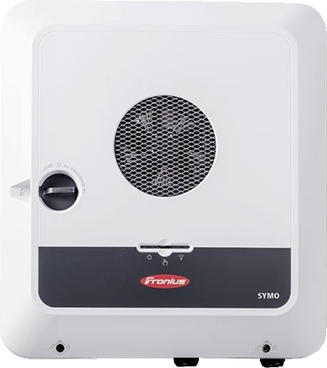

.. index:: Plugins; fronius
.. index:: fronius

=======
fronius
=======

Das Plugin dient zum Anschluss von Solarwechselrichtern der
Firma Fronius an smarthomeNG. Es liest die Information des
Wechselrichters über das REST API aus. Der Wechselrichter
wird mit konstantem Zyklus abgefragt. Die zurückgegebenen
JSON Container werden in smarthome Items umgesetzt.

Unterstützte Geräte
===================

Fronius Symo GEN24

Konfiguration
=============

Die Pluginparameter und die Informationen zur Item-spezifischen Konfiguration des Plugins sind
unter :doc:`/plugins_doc/config/fronius` beschrieben.

plugin.yaml
-----------

Nachfolgend eine Beispielkonfiguration:

.. code-block:: yaml

    fronius:
        plugin_name: fronius
        poll_cycle: 10
        ip_address: 192.168.1.181

items.yaml
----------

Items für das plugins müssen den Eintrag ``fronius_data: xxx`` enthalten. Es gibt
folgende Möglichkeiten für xxx:

- soc: Ladezustand der Batterie
- p_pv: Aktuelle PV Leistung
- p_grid: Aktuelle Leistung vom Netz
- p_accu: Aktuelle Leistung aus der Batterie
- p_load: Aktueller Verbrauch der Hauses
- p_pv_day: Aktuell erzeugte Energie des Tages
- p_pv_day_database: Item für Tagesenergie in der Datenbank

Nachfolgend eine Beispielkonfiguration:

.. code-block:: yaml

    Solar:
      BatterySOC:
        type: num
        fronius_data: soc
      BatteryPower:
        type: num
        fronius_data: p_accu
      SolarPower:
        type: num
        fronius_data: p_pv
        database: yes
      SolarDailyPower:
        type: num
        fronius_data: p_pv_day
      SolarDailyPowerDatabase:
        type: num
        database: yes
        fronius_data: p_pv_day_database
      HousePower:
        type: num
        database: yes
        fronius_data: p_load

Tagesenergie
------------

Umrichter der Serie GEN24 geben über das REST API keine Energiesummen aus.
Das Plugin berechnet sie daher selber. Dazu wird die PV Leistung p_pv über
den Tag aufintegriert. Die dabei berechnete Energie kann stets aktuell
über p_pv_day abgefragt werden. Die Berechnung erfolgt über eine Funktion
des database plugins. p_pv muss daher mit database: yes definiert werden.

Zu Mitternacht wird der Wert p_pv_day auf den Wert p_pv_day_database kopiert
und zu Null gesetzt. Somit kann der nächste Tage gezählt werden. Der Wert
p_pv_day_database kann in der Datenbank gespeichert werden. Dann hat man
eine Statistik über die Tagesenergie.

Web Interface
=============

Das Plugin stellt ein WebIF zur Verfügung, in dem alle mit dem Plugin verknüpften Items gelistet sind.
