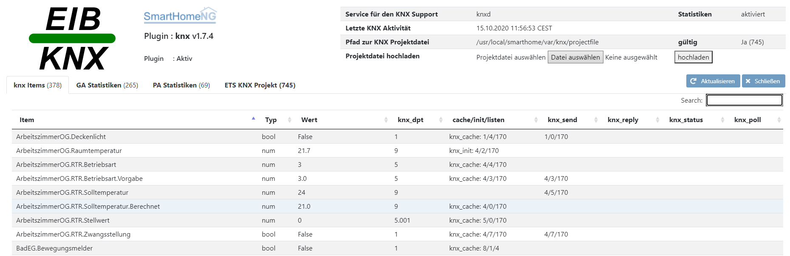
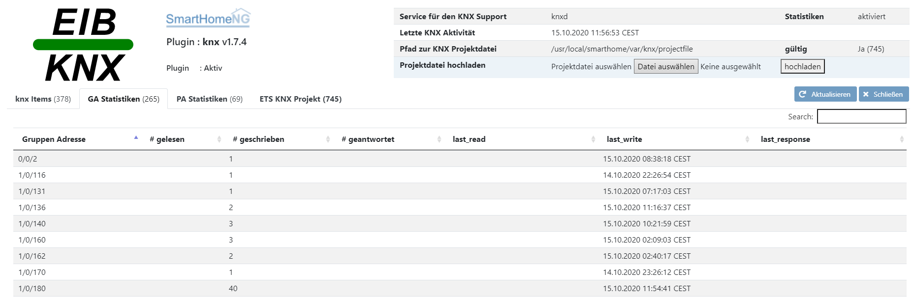
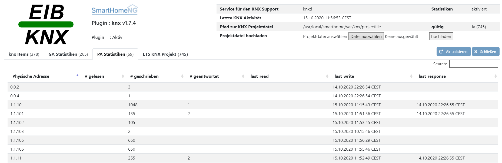
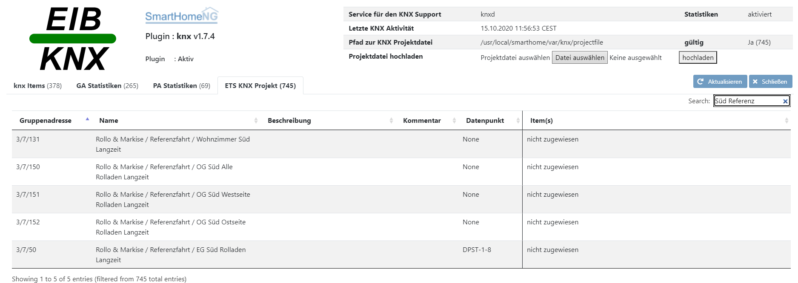

.. index:: Plugins; knx (KNX Bus Unterstützung)
.. index:: knx

===
knx
===

Konfiguration
=============

Die Informationen zur Konfiguration des Plugins sind unter :doc:`/plugins_doc/config/knx` beschrieben.

plugin.yaml
-----------

Bitte die Dokumentation lesen, die aus den Metadaten der ``plugin.yaml`` erzeugt wurde.

Nachfolgend eine Beispielkonfiguration für das Logging der eingehenden KNX Telegramme auf einen separaten
Logger. Die einzelnen Abschnitte müssen in die ``logging.yaml`` integriert werden:

.. code-block:: yaml
   :emphasize-lines: 2-4,7-12,15-17

   formatters:
      busmonitor:
         format: '%(asctime)s;%(message)s'
         datefmt: '%Y-%m-%d %H:%M:%S'

   handlers:
      busmonitor_file:
         class: logging.handlers.TimedRotatingFileHandler
         formatter: busmonitor
         when: midnight
         backupCount: 7
         filename: ./var/log/knx_busmonitor.log

   loggers:
      knx_busmonitor:
         level: INFO
         handlers: [busmonitor_file]

Mit dieser Konfiguration werde alle busmonitor Mitteilungen in
``./var/log/knx_busmonitor.log`` geschrieben.

items.yaml
~~~~~~~~~~

Bitte die Dokumentation lesen, die aus den Metadaten der ``plugin.yaml`` erzeugt wurde.

Nachfolgend eine Datei mit Beispielen für Item Definitionen unter Berücksichtigung des KNX Plugins

.. code-block:: yaml

   living_room:

       light:
           type: bool
           knx_dpt: 1
           knx_send: 1/1/3
           knx_listen:
           - 1/1/4
           - 1/1/5
           knx_init: 1/1/6

       temperature:
           type: num
           knx_dpt: 9
           knx_send: 1/1/6
           knx_reply: 1/1/6
           # see 1-Wire plugin
           ow_addr: '28.BBBBB20000'
           ow_sensor: T

       window:
           type: bool
           knx_dpt: 1
           knx_poll:
           - 1/1/9
           - 60

logic.yaml
~~~~~~~~~~

Bitte die Dokumentation lesen, die aus den Metadaten der ``plugin.yaml`` erzeugt wurde.

.. code-block:: yaml
   :caption: etc/logics.yaml

   logic1:
       knx_dpt: 9
       knx_listen: 1/1/7

   logic2:
       knx_dpt: 9
       knx_reply:
       - 1/1/8
       - 1/1/8

Im Kontext des KNX Plugins beinhaltet das Dictionary ``trigger`` folgende Elemente:

-  trigger['by'] Protokoll ('KNX')
-  trigger['source'] Physikalische Adresse der Paketquelle; bei Startwerten (siehe unten) mit dem Suffix ``:init``
-  trigger['value'] der Wert

Funktionen
~~~~~~~~~~

Bitte die Dokumentation lesen, die aus den Metadaten der ``plugin.yaml`` erzeugt wurde.

Beispiele zur Nutzung der Zeitfunktionen:

``sh.knx.send_time('1/1/1', '1/1/2')``
   Die Zeit senden an ``1/1/1`` und das Datum an ``1/1/2``

``sh.knx.send_time('1/1/1')``
   Nur die Zeit an ``1/1/1`` senden

``sh.knx.send_time(data_ga='1/1/2')``
   Nur das Datum an ``1/1/2`` senden

Alternativ zu diesen Funktionen kann auch das Plugin Attribut ``send_time`` genutzt werden.

Umwandlungen der Datentypen in Itemwerte
~~~~~~~~~~~~~~~~~~~~~~~~~~~~~~~~~~~~~~~~~~~

Die Umwandlungen der Werte vom KNX in einen Itemwert und von Itemwerte zum KNX entsprechen den Festlegungen
des Dokuments **03_07_02_Datapoint Types v02.01.02 AS** der **KNX System specifications**.

Es gibt Situationen wo der KNX Werte liefern kann die nicht als Itemwert zugelassen sind.
Ein Beispiel dafür ist der Datenpunkt Typ 14 der eine 4 Byte umfassende Fließkommazahl codiert.
Werte die ungültig sind und vom KNX geliefert werden entsprechen in Python einem Wert ``NaN``.
Da dieser Wert (Not a Number) in Items von SmartHomeNG nicht zugelassen ist wird die Zuweisung auf ein Item unterdrückt
und eine Warnung in das entsprechende Logfile geschrieben (wenn konfiguriert)

.. _knxd-einrichten:

knxd einrichten
===============

Das Plugin verbindet sich per TCP mit dem knxd (Standard: ``127.0.0.1:6720``, siehe Plugin Parameter ``host`` und ``port``).
Die Beispiele gelten für knxd 0.14 und neuer, der seine Konfiguration aus einer INI Datei liest.

Group Cache
-----------

Items mit dem Attribut ``knx_cache`` werden beim Start aus dem Group Cache des knxd initialisiert. Der knxd hat nur dann
einen Group Cache, wenn er dafür konfiguriert ist. Die vom knxd mitgelieferte Vorlage ``systemd/knxd.conf``
enthält keine entsprechende Option::

   KNXD_OPTS="-e 0.0.1 -E 0.0.2:8 -u /tmp/eib -b ip:"

Ohne Group Cache lehnt der knxd die Cache-Anfragen des Plugins ab. Das Plugin schreibt dann eine Warnung ins Log und
alle Items mit ``knx_cache`` behalten ihren Startwert.

Der Group Cache wird in der INI Datei mit der Option ``cache`` im Abschnitt ``[main]`` eingeschaltet. Ihr Wert ist der
Name eines Abschnitts. Hat der Group Cache keine eigenen Parameter, muss dieser Abschnitt nicht existieren.

.. hint::

   Der Group Cache sollte über die INI Datei eingeschaltet werden. Die Kommandozeilen-Option ``-c`` (``--GroupCache``)
   ist veraltet und wird vom knxd beim Start in dieselbe ``cache`` Option umgewandelt. Eine Rückmeldung aus der Praxis
   berichtet, dass der Cache mit ``-c`` nicht funktioniert, mit der INI Datei dagegen schon.
   Die Ursache ist nicht geklärt. Bei der Umstellung hilft ``knxd_args`` (siehe unten).

Beispiel für ``/etc/knxd.ini`` mit einer KNX/IP-Schnittstelle als Tunnel (entspricht ``-b ipt:<IP>``):

.. code-block:: ini
   :caption: /etc/knxd.ini

   [main]
   addr = 0.0.1
   client-addrs = 0.0.2:8
   connections = interface
   systemd = systemd
   cache = cache

   [interface]
   driver = ipt
   ip-address = 192.168.10.38

   [systemd]

   [cache]
   max-size = 1000

``addr`` ist die KNX Adresse des knxd (entspricht ``-e``), ``client-addrs`` der Adressbereich für seine Clients
(``-E``). Beide müssen zur eigenen KNX Installation passen. ``max-size`` begrenzt die Zahl der gespeicherten
Gruppenadressen und kann entfallen.

Der knxd wird mit dieser Datei gestartet, indem in ``/etc/knxd.conf`` (bei Betrieb mit systemd) nur diese Zeile steht::

   KNXD_OPTS=/etc/knxd.ini

Wird der knxd ohne systemd betrieben, muss er selbst auf dem TCP Port lauschen. Dafür wird in ``[main]`` bei
``connections`` ein zusätzlicher Abschnitt mit ``server = knxd_tcp`` (Port 6720) eingetragen. Bei systemd übernimmt
das ``knxd.socket``.

Bestehende Kommandozeilen-Optionen können mit dem Programm ``knxd_args`` in eine INI Datei umgewandelt werden.
Die Konfiguration lässt sich mit ``stop-after-setup = true`` im Abschnitt ``[main]`` prüfen: der knxd beendet sich
dann nach dem Einlesen der Datei.

Funktionsweise des Cache-Lesens
-------------------------------

- Der knxd speichert im Arbeitsspeicher nur Telegramme (Schreiben und Antworten), die nach seinem Start über den Bus
  gelaufen sind. Direkt nach einem Neustart des knxd ist der Cache leer.
- Fehlt eine Gruppenadresse im Cache, sendet der knxd ein Lesetelegramm auf den Bus und wartet darauf nur 75 ms.
  Antwortet das Gerät später, wird die Antwort zwar im Cache gespeichert, die Cache-Anfrage des Plugins ist dann aber
  bereits mit einem leeren Ergebnis beantwortet.
- Das Plugin wiederholt deshalb die Anfrage für alle Gruppenadressen ohne Wert nach 2, 5 und 15 Sekunden
  (``KNXD_CACHEREAD_RETRY_DELAYS`` in ``globals.py``). Trifft während dieser Zeit ein Telegramm für die Gruppenadresse
  ein, wird sie nicht mehr angefragt.
- Die Wiederholungen laufen über eine eigene, kurzlebige Verbindung zum knxd (Wartezeit auf die Antworten:
  ``KNXD_CACHEREAD_TIMEOUT``). Beobachtet wurde, dass der knxd auf der Verbindung des Gruppenmonitors nach einer
  Cache-Anfrage alle Gruppentelegramme ablehnt. Das Plugin sendet dort deshalb nur die Cache-Anfragen der Startphase.
- Gruppenadressen, die danach noch ohne Wert sind, werden mit dem Loglevel aus dem Parameter
  ``loglevel_knxd_cache_problems`` protokolliert und im Webinterface rot markiert.
- Werte, die ein Item beim Start initialisieren, tragen im Source den Suffix ``:init``, z.B.
  ``knx:1.1.5:ga=1/1/1:init``. Das betrifft die Antworten des knxd-Caches (``knx_cache``), die verspätete Antwort des
  Busses auf eine vom knxd gestellte Leseanforderung und die erste Antwort auf ein ``knx_init``. Schreibtelegramme
  (z.B. von einem Taster) sind nie markiert, auch nicht während der Startphase. Der Source beginnt weiterhin mit der
  physikalischen Adresse, bestehende Muster wie ``^KNX:1.1.4:ga`` treffen also weiter zu.
  Mit dem Suffix lassen sich Startwerte filtern, z.B. in der stateengine mit
  ``se_manual_exclude: ^KNX:.*:init$``, damit sie nicht als manueller Eingriff zählen.
- Das Gerät, das den Wert liefern soll, muss für das Kommunikationsobjekt in der ETS das Lese-Flag gesetzt haben.

Beispiele
=========

**ToDo ...**

Statistiken
===========

Die Statistikfunktionen wurden eingebaut um zu sehen, was dauerhaft am KNX passiert.
Es wird aufgezeichnet welches Gerät (physikalische Adresse) Gruppenadresse als Leseanforderung abfragt oder als Schreibanforderung einen neuen Wert sendet.
Auf diese Weise werden folgende Fragestellungen beantwortet:

- Welches physikalische Gerät hat eine Anforderungen initiiert (Herkunft)
- Welche Art Anforderung wurde gestartet (lesen, schreiben, antworten)
- Welche Gruppenadresse wurde für welche Anforderung wie oft genutzt?
- Gibt es unbekannte physikalische Geräte

Web Interface
=============

Das Plugin Webinterface kann aus dem Admin Interface aufgerufen werden. Dazu auf der Seite Plugins in der entsprechenden
Zeile das Icon in der Spalte **Web Interface** anklicken.

Oben rechts werden allgemeine Parameter zum Plugin angezeigt.
Unter dem ersten Tab werden die Items die das Plugin nutzen übersichtlich dargestellt:

Der zweite Tab zeigt Statistiken zu den Gruppenadressen:

.. hint::

   Wenn es Items gibt, die mit dem Attribut ``knx_cache`` und einer Gruppenadresse konfiguriert wurden wird SmartHomeNG beim Start
   diese Gruppenadressen vom knxd abfragen.
   Wenn die Werte der Gruppenadressen zu diesem Zeitpunkt nicht im knxd vorliegen wird dieser eine Leseanforderung absetzten um die Werte zu bekommen.
   Dabei wartet der knxd nur 75 ms auf die Antwort, das Plugin fragt unbeantwortete Gruppenadressen deshalb nach 2, 5 und 15 Sekunden erneut ab
   (siehe :ref:`knxd einrichten <knxd-einrichten>`).
   Schlägt der Versuch fehl oder sind aus anderem Grund keine Werte im Cache des knxd vorhanden dann sendet dieser ein fehlerhaftes Datenpaket
   in dem nur Absender und Empfängeradresse enthalten sind. Die weiteren 2 Bytes mit Kontroll- und Dateninformationen fehlen jedoch.
   Daraus lässt sich auch nicht feststellen, ob die Empfängeradresse eine physikalische Adresse oder eine Gruppenadresse ist.
   Das Plugin merkt sich diese Empfängeradresse, interpretiert sie als Gruppenadresse und speichert sie in einer internen Liste.
   Im Webinterface werden alle Items mit ``knx_cache`` und der zugeordneten Gruppenadresse mit dieser Liste verglichen.
   Taucht die Gruppenadresse dort auf, wird der Eintrag rot eingefärbt als Hinweis das die Konfiguration überprüft werden sollte.
   Oftmals haben knx Geräte für eine Gruppenadresse die mit knx_cache ausgelesen werden soll kein Leseflag in der ETS gesetzt bekommen.
   Es ist möglich den Loglevel mit dem diese fehlerhaften Rückmeldungen geloggt werden in der Plugin Konfiguration festzulegen.

Der dritte Tab zeigt Statistiken zu den physikalischen Adressen:

Über das Webinterface kann eine Projektdatei aus der ETS hochgeladen werden um zu prüfen ob es Items ohne Zuweisung zu Gruppenadressen gibt
oder auch Gruppenadressen die keine Items definiert haben.
Kompatibel sind Exportdateien aus der ETS5 (\*.knxproj) oder ETS4 (\*.esf = OPC).
Es ist möglich für geschützte Projektdateien ein Passwort mit anzugeben. Dieses Passwort wird dann intern für die Laufzeit in SmartHomeNG
gespeichert und steht dort solange zur Verfügung bis ein Neustart erfolgt oder bis ein anderes Passwort zugewiesen wird.
Ebenfalls ist es möglich im Abschnitt in der Plugin.yaml ein Passwort zu definieren. Ist ein solches definiert und erfolgt ein Upload unter
Angabe eines neuen Passwortes, so wird das vorbelegte intern überschrieben. Erst nach einem Neustart ist das in der Plugin.yaml definierte
Passwort dann wieder vorhanden.

Nur wenn eine gültige Datei hochgeladen wurde wird ein vierter Tab angezeigt.
Hier wird dann der Vergleich zwischen den definierten Gruppenadressen aus der ETS mit den in SmartHomeNG konfigurierten
Items und deren knx spezifischen Attributen dargestellt.
Gibt es eine Gruppenadresse, die in der ETS definiert wurde aber keine Entsprechung in SmartHomeNG hat,
so erscheint in der rechten Spalte *nicht zugewiesen*.

Alle Tabellen im Webinterface haben rechts oben eine Filter- bzw. Suchmöglichkeit vorgesehen.
Damit lassen sich die angezeigten Daten begrenzen. So kann z.B. gezielt nach bestimmten
Gruppenadressen, Attributen oder nicht zugewiesenen Gruppenadressen  gesucht werden.

.. important::

   Das Webinterface des Plugins kann mit SmartHomeNG v1.4.2 und davor **nicht** genutzt werden.
   Es wird dann nicht geladen. Diese Einschränkung gilt nur für das Webinterface. Ansonsten gilt
   für das Plugin die in den Metadaten angegebene minimale SmartHomeNG Version.
