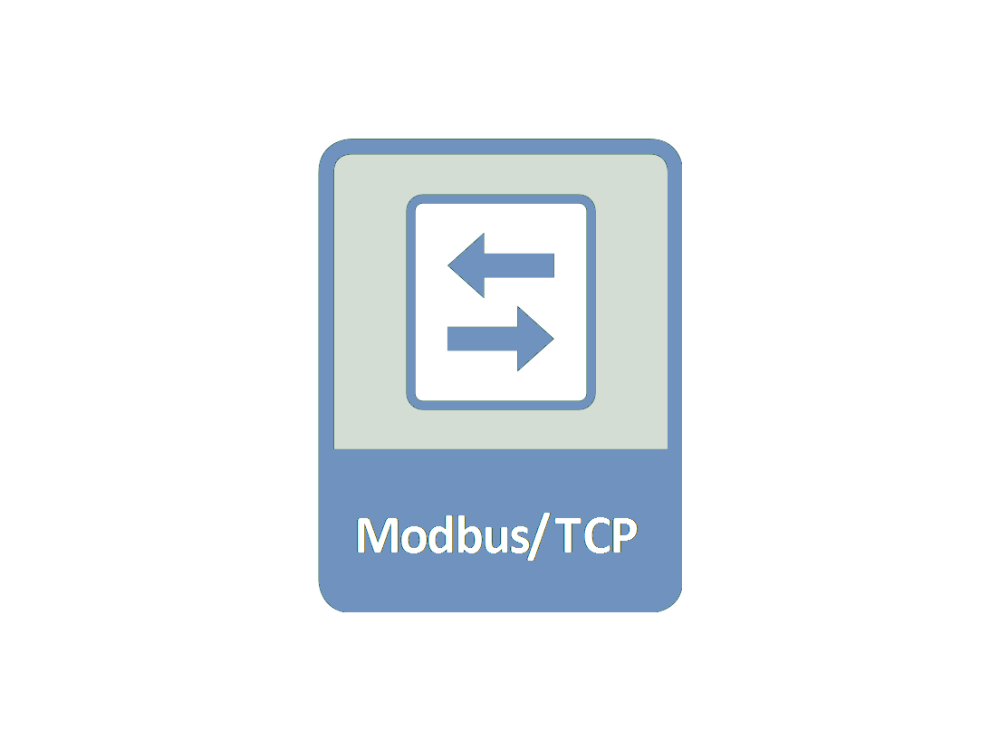
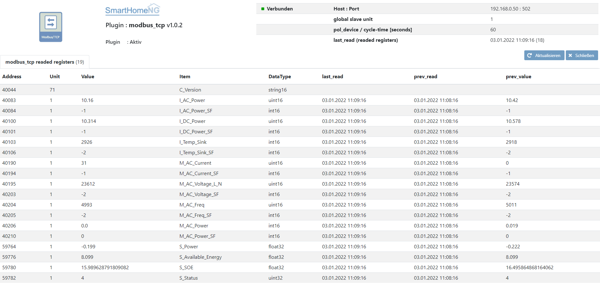

.. index:: modbus plugin
.. index:: Plugins; modbus

======
modbus
======

SmarthomeNG plugin, zum Lesen und Schreiben von Modbus-Registern. Nachfolger von modbus_tcp.

Anforderungen
=============

* pymodbus >= 3.9, < 3.10
* pyserial (für ``transport: rtu``)
* SmartHomeNG >= 1.11

Umstieg von modbus_tcp
----------------------

Die Item-Attribute (``modBus*``, ``modbusPoll``) und Plugin-Parameter sind dieselben wie bei
modbus_tcp 2.0. Für den Umstieg genügt es, in ``etc/plugin.yaml`` ``plugin_name: modbus_tcp``
durch ``plugin_name: modbus`` zu ersetzen. Unterschiede:

* Items mit unbekanntem ``modBusDataType`` werden beim Start einmal mit einer Warnung
  ignoriert, statt bei jeder Abfrage einen Fehler zu melden.
* ``modBusDirection: read_write`` oder ``write`` bei ``InputRegister``/``DiscreteInput``
  wird auf Lesen reduziert.
* Mehrere Items dürfen dasselbe Register verwenden (z.B. ``uint8_high``/``uint8_low``).

Abfragemodi
-----------

* ``cycle > 0``: Eine vollständige Abfrage pro Scheduler-Aufruf.
* ``cycle: 0``: Keine periodische Abfrage; Crontab oder Poll-Item können weiterhin abfragen.
* ``cycle: -1``: Kontinuierliche Abfragen mit kurzer Pause zwischen Registern.

Benachbarte Register (gleiche Unit, gleiche Tabelle) werden mit einer Anfrage gelesen, bis
125 Register bzw. 2000 Bits; Lücken werden nicht mitgelesen. Antwortet das Gerät auf eine solche
Anfrage mit einem Fehler, werden ihre Register einzeln gelesen. Meldet das Gerät für ein Item
"illegal data address" (Exception-Code 2: das Register gibt es auf diesem Gerät nicht), wird das
Item mit einer Warnung bis zur nächsten Verbindung nicht mehr gelesen. So passt ein Profil für eine
Gerätefamilie auch auf Modelle, denen einzelne Register fehlen.

Die Werte werden nach jeder erfolgreichen Abfrage direkt in die Items geschrieben;
es gibt keinen separaten Flush-Puffer. Ein boolesches Item mit ``modbusPoll: true``
löst bei einem externen Wechsel auf true eine vollständige Abfrage aus.
Vor erneutem Auslösen das Item auf false zurücksetzen. Überlappende Abfragen
werden übersprungen. Ohne Abfragemodus, Poll-Item oder Schreib-Items wird keine
TCP-Verbindung geöffnet.

Datentypen
----------

``modBusDataType``, Größe in Bit (Zahlen, Bitlisten) bzw. Byte (Strings); ohne Größe gilt 16.

============================== ===============================================================
Datentyp                       Bedeutung
============================== ===============================================================
``uint16/32/64``               Ganzzahl ohne Vorzeichen; 0xFFFF... gilt als "kein Wert"
``int16/32/64``                Ganzzahl mit Vorzeichen; der kleinste Wert gilt als "kein Wert"
``float32/64``                 Gleitkommazahl; float32 als kürzeste Dezimalzahl desselben
                               Werts (23.4 statt 23.399999618530273)
``stringN``                    ASCII-Text mit N Byte, endet am ersten NUL; Schreiben füllt mit
                               NUL auf N Byte auf (Word-Order wirkt nicht)
``bitN``                       Liste von N Bits, höchstwertiges Bit zuerst
``uint8_high``/``uint8_low``   oberes/unteres Byte eines Registers, nur lesbar
``ipv4``                       IPv4-Adresse aus 32 Bit, z.B. ``192.168.2.40``
``datetime32``                 Sekunden seit 1970 als ``datetime`` (Item-Typ ``datetime``),
                               ohne Zeitzonen-Umrechnung: die Uhr des Geräts
``date32``/``time32``          dasselbe als Datum bzw. Uhrzeit (Item-Typ ``foo``), nur lesbar
``hhmm``                       Uhrzeit als Dezimalziffern, 1530 = ``'15:30'`` (str); Schreiben
                               auch ``'7:45'``
``ddmm``                       Tag im Jahr als Dezimalziffern, 1503 = ``'15.03.'`` (str, ohne
                               Jahr); Schreiben auch ``'15.3'``
``pluggit_*``                  Pluggit-Formate ``pluggit_mac``, ``pluggit_version``,
                               ``pluggit_version_bcd``, nur lesbar
============================== ===============================================================

Weitere Item-Attribute formen den gelesenen Wert:

* ``modBusBit: N``: das Bit N (0 = niederwertigstes) des Werts als bool; so lesen mehrere
  bool-Items die Bits eines Registers. Einzelne Bits schreibt nur ein Adapter (s.u.).
* ``modBusRound: N``: auf N Nachkommastellen runden, 0 ergibt eine ganze Zahl. Ein str-Item erhält
  Text mit genau N Nachkommastellen (210 mit ``modBusFactor: 0.01`` und N=2: ``'2.10'``).
* ``modBusLookup``: Werteliste Gerätewert -> Item-Wert, als Python-Literal in Anführungszeichen
  (eine YAML-Abbildung wäre ein Kind-Item). Schreiben sendet den Gerätewert des Item-Werts;
  nicht gelistete Gerätewerte kommen unverändert im Item an.

.. code-block:: yaml

    betriebsart:
        type: str
        modBusAddress: 472
        modBusLookup: "{0: 'Standby', 1: 'Manuell', 3: 'Wochenprogramm'}"

Reihenfolge beim Lesen: dekodieren, "kein Wert" prüfen, ``modBusFactor``, SunSpec-Skalierung,
``modBusRound`` (bzw. ``modBusBit``), ``modBusLookup``; beim Schreiben umgekehrt.

Werte, die "kein Wert" bedeuten, werden nicht in das Item geschrieben: die des Datentyps (siehe
oben) und die in ``modBusInvalid`` gelisteten (gelesener Wert vor ``modBusFactor``, z.B.
``modBusInvalid: [32767]`` für einen fehlenden Fühler). Hat ein solcher Wert eine
fachliche Bedeutung (z.B. Wechselrichterleistung nachts), setzt ``modBusInvalidValue`` den
Item-Wert dafür, ohne ``modBusFactor``. Lesefehler und Verbindungsabbrüche lassen das Item
immer unverändert. ``modBusFactor`` wird nach dem Dekodieren angewendet (Lesen) bzw. vor dem
Kodieren herausgerechnet (Schreiben).

Geräteprofile
-------------

Für unterstützte Geräte liefert das Plugin fertige Item-Structs. Ein Profil gliedert sich in
Gruppen. Schreibbare Register tragen ``modBusDirection: read_write`` und liegen in ihrer Gruppe
wie die lesbaren; ihr ``remark`` (im Admin-Interface bei den Item-Details) lautet
``writable (modBusDirection: read_write)``.

.. code-block:: yaml

    pv:
        s10:
            struct: modbus.e3dc.s10            # alle Gruppen
        soc:
            struct: modbus.e3dc.s10.state      # nur eine Gruppe

Bei mehreren Instanzen zusätzlich ``instance: <abschnitt>`` am Item setzen, mit dem Namen des
Abschnitts aus ``etc/plugin.yaml`` (z.B. ``instance: modbus_e3dc`` für den Abschnitt ``modbus_e3dc:``).

Kostal-Geräte antworten auf Unit-ID 71: ``slaveUnit: 71`` in der Plugin-Konfiguration setzen.
Die Kostal-Structs enthalten alle Register von kostalmodbus bzw. ksemmodbus; statt der Attribute
``kostal_<adresse>``/``ksem_<adresse>`` bindet man den Struct (oder eine Gruppe davon) ein.

Der Systemair-Struct enthält die Items von ``systemair.yaml`` mit gleichen Namen
(``struct: modbus.systemair.residential`` an Stelle des kopierten ``kwl``-Baums); Verbindung mit
``transport: rtu``.

Der Pluggit-Struct hat die Item-Pfade des Structs ``pluggit.pluggit``; die Plugin-Instanz braucht
``adapter: pluggit``. Abweichungen: ``FirmwareVersion``/``HACFirmwareVersion`` sind str,
``SystemTime.DateTime`` ist vom Typ datetime, ``SystemTime`` ist nur lesbar (die Uhr stellt das
neue Item ``SystemTime.Set``), ``WeekProgram`` ist nur lesbar und die Tagesprogramme fehlen (das
pluggit-Plugin hat sie nie dekodiert).

Die Huawei-Structs entsprechen denen von modbus_tcp (gleiche Item-Pfade, schreibbare Register
noch in ihren Gruppen); beim Umstieg genügt ``struct: modbus_tcp.huawei...`` ->
``struct: modbus.huawei...``. Ausnahme: die Gruppe ``meter.type`` heißt jetzt ``meter.meter_type``
(der Name ``type`` verhinderte das Anlegen der Items).

================================ =========================================================== ============
Struct                           Gerät                                                       Quelle
================================ =========================================================== ============
``modbus.e3dc.s10``              E3/DC S10, "simple mode"                                    neu
``modbus.huawei.<gerät>``        Huawei SmartLogger, SDongle, Meter, Inverter, Storage, EMMA modbus_tcp
``modbus.kostal.plenticore``     Kostal PLENTICORE plus / PIKO IQ                            kostalmodbus
``modbus.kostal.ksem``           Kostal Smart Energy Meter                                   ksemmodbus
``modbus.systemair.residential`` Systemair VR, VTC, VTR, VSR (RTU)                           systemair
``modbus.pluggit.ap310``         Pluggit AP310 (``adapter: pluggit``)                        pluggit
================================ =========================================================== ============

Mit dem modbus-Plugin an echter Hardware getestet (nur Lesen): ``modbus.e3dc.s10`` mit einem S10 SE
(Firmware H20_2026_44, Modbus-Version 1.2). Der S10 braucht dafür das Protokoll "E3/DC"; mit "SunSpec" entfällt dieser
Registerblock, und die SunSpec-Batteriemodelle des S10 liefern keine Werte (SoC nicht verfügbar).

Die Profile liegen als Quelle unter ``plugins/modbus/profiles/<hersteller>/<gerät>.yaml``. Ein
Profil lässt sich lokal anpassen, ohne die plugin.yaml zu verändern: es wird nach
``structs/modbus_<hersteller>.yaml`` exportiert und dort bearbeitet.

.. code-block:: shell-session

    cd /usr/local/smarthome
    python -m plugins.modbus.profiles export e3dc.s10 --structs-dir structs

Der exportierte Struct heißt dann ``my.modbus_e3dc.s10``. Der Export ist nur lesbar: schreibbare
Register werden ``modBusDirection: read`` (reine Schreib-Register bleiben ungebunden), ihr
``remark`` nennt weiterhin die Schreibrichtung. ``--writable`` übernimmt die Richtungen des Profils.
Einzelne Register gibt ``modBusDirection: read_write`` am eigenen Item frei, es geht dem Struct vor.
Das gilt je Item: bei einem Listen-Register mit Kind-Item ``text`` braucht das Kind-Item die Angabe
selbst, wenn über den Listentext geschrieben werden soll:

.. code-block:: yaml

    heizung:
        sommergrenze:
            struct: my.modbus_samson.trovis557x.SommerAT_Wert
            modBusDirection: read_write
        betriebsart:
            struct: my.modbus_samson.trovis557x.BetriebsArtRk1
            text:
                modBusDirection: read_write     # schreibt 'Hand' als 3

Optionale Profile stehen wegen ihrer Größe nicht in der plugin.yaml und werden nur exportiert:

=============================== ========================================== ============
Profil                          Gerät                                      Quelle
=============================== ========================================== ============
``samson.trovis557x``           SAMSON TROVIS 5571/5573/5576/5578/5579     trovis557x
=============================== ========================================== ============

Im TROVIS-Profil ist jeder Wert ein eigener Struct mit dem Kurznamen des trovis557x-Plugins
(``-`` und ``#`` werden zu ``_``). Beim Umstieg wird ``trovis557x_var: Firmware-Version`` zu
``struct: my.modbus_samson.trovis557x.Firmware_Version`` und ``invalid_to_zero: true`` zu
``modBusInvalidValue: 0``; die Plugin-Instanz braucht ``slaveUnit`` (Stationsadresse, beim
trovis557x-Plugin ``modbus_trovis_address``, Standard 247) und die seriellen Parameter.
Register, die ein Modell nicht hat, lehnt der Regler ab; das Plugin liest sie dann nicht mehr (siehe
oben). Abweichungen: Listen-Register (z.B. Schalterstellung) haben die Zahl als Item-Wert und den
Listentext im Kind-Item ``text`` (das Attribut ``liste`` entfällt, die Einheit steht in ``name``);
Coils sind bool, nur ferngesteuert/autark und fallend/steigend haben ein ``text``-Kind;
Uhrzeiten lauten ``'09:05'`` statt ``'9:05'``; 32767 (kein Fühler) bei vorzeichenbehafteten
Messwerten lässt das Item unverändert statt 3276.7 zu schreiben. Das trovis557x-Plugin schrieb nie;
im Profil sind die dort als ``rw`` markierten Werte (Sollwerte, Uhrzeit, Schalter, Coils)
``read_write``, wirksam mit ``--writable`` oder je Item (s.o.).

Entwickler: nach einer Änderung an ``profiles/`` die plugin.yaml mit
``python -m plugins.modbus.profiles generate`` aktualisieren; ``check`` meldet veraltete
Structs, ein Test prüft dasselbe.
``python -m plugins.modbus.profiles import-struct <hersteller>`` schreibt die ``item_structs``
eines Herstellers aus der plugin.yaml des modbus_tcp-Plugins (oder ``--source <plugin.yaml>``) als
Profile; vorhandene Profildateien behalten alles oberhalb von ``groups:``, neue sind ``optional``.
Die huawei-Profile sind so entstanden, ein Test vergleicht sie mit dem aktuellen Import.

SunSpec
-------

Geräte mit SunSpec-Schnittstelle (viele Wechselrichter, Zähler und Speicher) adressiert man
über Namen statt Registernummern. Das Plugin liest beim Verbinden die Modell-Kette des Geräts
und ermittelt daraus Adressen und Skalierungsfaktoren; nach jedem Neuverbinden erneut.

.. code-block:: yaml

    wr:
        leistung:
            type: num
            modBusSunSpec: 103.W                # Modell 103, Punkt W
        hersteller:
            type: str
            modBusSunSpec: 1.Mn
        string2:
            type: num
            modBusSunSpec: 160.module.2.DCW     # wiederholte Gruppe: Index ab 1
        zweiter_zaehler:
            type: num
            modBusSunSpec: 203:2.W              # zweites Modell 203 am Gerät
        begrenzung:
            type: num
            modBusSunSpec: 123.WMaxLimPct
            modBusDirection: read_write

Modell- und Punktnamen stehen in den SunSpec-Modelldefinitionen
(https://github.com/sunspec/models); das Plugin liefert sie als ``sunspec_models.json`` mit.
Skalierungsfaktoren (``*_SF``) werden automatisch angewendet, auch beim Schreiben.
``modBusUnit``, ``modBusDirection`` und ``modBusInvalidValue`` gelten wie bei Registern.
Punkte, die das Gerät nicht hat, meldet das Log einmal als Warnung; das Item bleibt unverändert.

Welche Punkte ein Gerät bietet, zeigt der Reiter "SunSpec" des Web Interface über die Verbindung
der Plugin-Instanz (Unit-ID eingeben, Liste mit Item-Adresse, aktuellem Wert, Einheit, Bezeichnung
und Register), auch ohne SunSpec-Items. Ohne laufendes SmartHomeNG zeigt dieselbe Liste (aus dem
SmartHomeNG-Basisverzeichnis):

.. code:: shell-session

    python -m plugins.modbus.sunspec scan --host 192.168.0.50 --port 502 --unit 1

Entwickler: neue Modelldefinitionen mit
``python -m plugins.modbus.sunspec convert <models-checkout>/json --source "sunspec/models <commit>"``
übernehmen.

pymodbus
--------

das Paket sollte automatisch von SH installiert werden.

pymodbus - manuelle Installation:
---------------------------------

.. code:: shell-session

    python3 -m pip install pymodbus --user --upgrade

Konfiguration
=============

plugin.yaml
-----------

.. code-block:: yaml

    solaredge:
        plugin_name: modbus
        host: 192.168.0.50
        port: 502
        cycle: 60
        plugin_enabled: true

    logoMB:
        plugin_name: modbus
        host: 192.168.0.80
        port: 502
        cycle: 20
        plugin_enabled: true

Verbindungsarten (Parameter ``transport``):

.. code-block:: yaml

    # Modbus TCP (Standard)
    wechselrichter:
        plugin_name: modbus
        host: 192.168.0.50
        port: 502

    # Modbus RTU an einer seriellen Schnittstelle
    lueftung:
        plugin_name: modbus
        transport: rtu
        serialport: /dev/ttyUSB0
        baudrate: 19200       # Standard 19200
        parity: N             # N, E, O
        stopbits: 1
        bytesize: 8
        slaveUnit: 1

    # RTU-Telegramme über TCP (serielle Gateways im "transparenten" Modus)
    heizung:
        plugin_name: modbus
        transport: rtu_over_tcp
        host: 192.168.0.60
        port: 502

Fehlt der für die Verbindungsart nötige Parameter (``host`` bzw. ``serialport``), wird das Plugin
nicht gestartet.

Mit ``invalidate_on_disconnect: true`` markiert das Plugin bei Verbindungsverlust die gelesenen
Items im Datenbank-Log als ungültig (Datenlücke statt fortgeschriebenem letztem Wert). Betrifft
nur Items mit ``database``-Attribut; die Item-Werte bleiben unverändert.

Geräte-Logik über reine Register hinaus liefert ein Adapter (Parameter ``adapter``):

* ``pluggit``: bool-Items mit ``modBusBit`` auf dem Betriebsart-Register 168 schalten die
  Betriebsart ein bzw. aus (Bedarf, Handbetrieb und Wochenprogramm lassen sich nur durch eine
  andere Betriebsart beenden); vor dem Schreiben der Lüfterstufe (Register 324) wird auf
  Handbetrieb geschaltet.

Bei mehreren Geräten wird pro Gerät ein Abschnitt angelegt (Multiinstanz). Items geben den
Abschnitt mit ``instance: <abschnitt>`` an oder hängen ``@<abschnitt>`` an die Attributnamen.

Bitte die Dokumentation lesen, die aus den Metadaten der plugin.yaml erzeugt wurde.

items.yaml
----------

Bitte die Dokumentation lesen, die aus den Metadaten der plugin.yaml erzeugt wurde.

logic.yaml
----------

Bitte die Dokumentation lesen, die aus den Metadaten der plugin.yaml erzeugt wurde.

Beispiel: In der Datei example.yaml sind ein paar Items für einen Solaredge-Wechselrichter SE6000 angelegt.

Funktionen
~~~~~~~~~~

Bitte die Dokumentation lesen, die aus den Metadaten der plugin.yaml erzeugt wurde.

Beispiele
---------
Beispiel für SH-Items

siehe auch example.yaml

.. code-block:: yaml

    mydevice:
        AI1:
            type: num
            name: AI1
            modBusObjectType: InputRegister     #(optional) default: HoldingRegister
            modBusAddress: 0
            modBusDataType: int16               #(optional) default: uint16
            #modBusByteOrder: 'Endian.Little'    #(optional) default: 'Endian.Big'
            #modBusWordOrder: 'Endian.Little'    #(optional) default: 'Endian.Big'
            modBusDirection: 'read_write'       #(optional) default: 'read'
            modBusUnit: '71'                    #(optional) default: slaveUnit aus der Plugin-Konfig
            #modBusFactor: 0.1                  #(optional) default: 1
            #modBusInvalid: [32767]             #(optional) weitere "kein Wert"-Werte des Geräts
            #modBusInvalidValue: 0              #(optional) Item-Wert bei "kein Wert"
            #modBusDirection: read_write        #(optional) default: 'read'
        AM1:
            type: num
            name: AM1
            modBusObjectType: HoldingRegister
            modBusAddress: 528
            modBusDirection: read_write
            #modBusFactor: 1
            #modBusDataType: int16
        M1:
            type: bool
            name: M1
            modBusObjectType: Coil
            modBusAddress: 8256
            modBusDataType: bit
            modBusDirection: read_write
        I1:
            type: bool
            name: I1
            modBusObjectType: DiscreteInput
            modBusAddress: 0
            modBusDataType: bit
        VM0:
            type: num
            name: VM0
            modBusObjectType: HoldingRegister
            modBusAddress: 0
            modBusDirection: read_write
            modBusFactor: 0.01

        geraetename:
            type: str
            #modBusObjectType: HoldingRegister  #(optional) default: HoldingRegister
            modBusAddress: 40030
            modBusDataType: 'string16'          #(optional) default: uint16
            #modBusFactor: '1000'               #(optional) default: 1
            modBusByteOrder: 'Endian.Little'    #(optional) default: 'Endian.Big'
            modBusWordOrder: 'Endian.Little'    #(optional) default: 'Endian.Big'
            modBusDirection: 'read_write'       #(optional) default: 'read'
            modBusUnit: '71'                    #(optional) default: slaveUnit aus der Plugin-Konfig
        temperatur:
            type: num
            modBusAddress: 40052
            modBusDataType: 'float32            #(optional) default: uint16
            #modBusFactor: '1'                  #(optional) default: 1
            modBusByteOrder: 'Endian.Little'    #(optional) default: 'Endian.Big'
            modBusWordOrder: 'Endian.Little'    #(optional) default: 'Endian.Big'
            modBusUnit: '71'                    #(optional) default: slaveUnit aus der Plugin-Konfig
        
        # Multiinstanz:
        # Jedes Attribut mit @<abschnitt> ergänzen (Name des Abschnitts in etc/plugin.yaml),
        # oder am Item instance: <abschnitt> setzen.
        M1:
            type: bool
            name: M1
            modBusObjectType@logoMB: Coil
            modBusAddress@logoMB: 8256
            modBusDataType@logoMB: bit
            modBusDirection@logoMB: read_write
        

Changelog
---------
V0.1.0  Nachfolger von modbus_tcp 2.0.0: Datentyp-Codecs, Register-Spezifikationen,
        Geräteprofile (E3/DC S10), ``uint8_high``/``uint8_low``, ``modBusInvalidValue``,
        ``invalidate_on_disconnect``, SunSpec (``modBusSunSpec``), ``modBusBit``,
        ``modBusLookup``, ``modBusRound``, ``modBusInvalid``, Datentypen
        ``ipv4``/``datetime32``/``date32``/``time32``/``hhmm``/``ddmm``, Adapter (Pluggit) und
        Pluggit-Profil, optionales TROVIS-557x-Profil, abgelehnte Register werden bis zur nächsten
        Verbindung nicht mehr gelesen, SunSpec-Reiter im Web Interface, ``remark`` an
        schreibbaren Profil-Registern, Profil-Export nur lesbar außer mit ``--writable``.
        Ältere Änderungen siehe Dokumentation von modbus_tcp.

Web Interface
=============

Das Plugin kann aus dem Admin Interface aufgerufen werden. Dazu auf der Seite Plugins in der entsprechenden
Zeile das Icon in der Spalte **Web Interface** anklicken.

